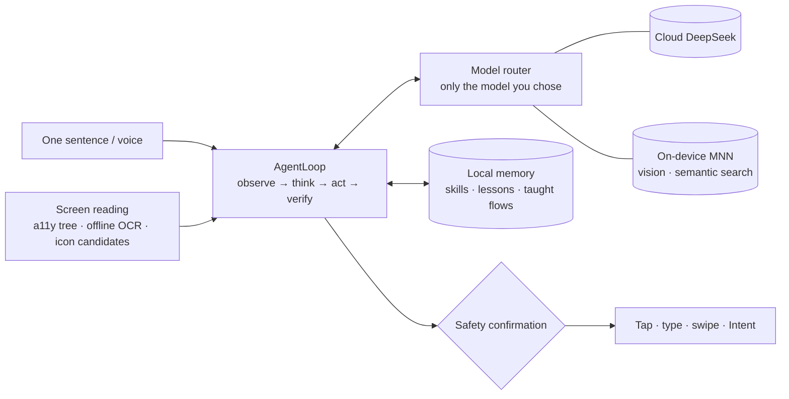

<div align="center">

<p><a href="README.md">简体中文</a> | <b>English</b></p>


# Tsuki · 月

**Say it once. Your phone does the rest.**

<sub>An autonomous Android phone agent on MNN — cloud-first, on-device assist, and it learns from you.</sub>

<br/>

[](https://github.com/Runa-Asahi/tsuki-phone-agent/releases)
[](LICENSE)
[](docs/HONOR_MAGICOS10.md)
[](docs/HONOR_MAGICOS10.md)
[](https://github.com/alibaba/MNN)

</div>

---

> [!IMPORTANT]
> ### 📱 Primary target device
> **Honor PPG-AN00** · MagicOS 10 · Android 16 · Snapdragon 8 Elite Leading Version · 2800 × 1264
>
> Tsuki is built and tested on this phone. Other Android devices are **unverified** — you're welcome to try, but results aren't guaranteed.

## What it does for you

| | |
|---|---|
| 🗣️ **One sentence, and your phone gets moving** | Say or type a goal — say, "WeChat Wang Xiaoming that I'll be late" — and Tsuki reads the screen, thinks, and taps, types and swipes its way through any app, showing you every step as it goes. |
| 🎓 **Show it once, it remembers** | "Teach me…": walk through a task by voice or by demonstration while a floating coach bar follows you into any app and records each step. Next time it follows the same path — and you can correct it when it slips. |
| 🌙 **Thinks harder when it's stuck** | Fast, shallow thinking by default. When it starts going in circles, it switches to deep thinking: looks at a screenshot, works out what went wrong, tries an approach it hasn't used yet, then drops back to fast mode once it's making progress. |
| 👁️ **Vision and voice, on the phone** | The vision model, semantic search and offline speech recognition all run locally with MNN / sherpa-onnx — those screenshots and recordings never leave your device. |
| 🛡️ **Always asks before anything risky** | Sending messages, calling, paying, ordering, uninstalling and setting alarms all need your OK first. Text on screen is never treated as an instruction, and a long-press on the floating moon stops everything instantly. |

## 📸 Screenshots

<div align="center">

<table>
  <tr>
    <td align="center"></td>
    <td align="center"></td>
  </tr>
  <tr>
    <td align="center"><sub><b>Home</b>: give it a task in one line; setup checklist and quick prompts at a glance</sub></td>
    <td align="center"><sub><b>Settings</b>: one-tap on-device model download; semantic search on or off</sub></td>
  </tr>
</table>

<sub>📱 Captured on an Honor PPG-AN00 (status bar cropped). The app UI is currently in Chinese.</sub>

</div>

## 🚀 Quick start

1. Download the latest APK from [Releases](https://github.com/Runa-Asahi/tsuki-phone-agent/releases) and install it.
2. Turn on **Accessibility**: Settings → Accessibility → Tsuki (double-check after every APK update).
3. Allow **Display over other apps** (for the floating moon, confirmation prompts and the coach bar).
4. Enter your **DeepSeek API key** in Tsuki's settings — it's only ever entered in the app and stored encrypted.
5. Menu → **Self-check**. Once everything passes, you're ready to go.

<details>
<summary><b>Advanced: Shizuku, keep-alive, on-device models</b></summary>

- **Shizuku (recommended)**: Developer options → Wireless debugging → pair and start Shizuku, then grant access in Tsuki's settings. You get key injection, faster raw screenshots, and automatic recovery if the accessibility service drops. On MagicOS, Shizuku has to be restarted after every reboot.
- **Keep-alive on Honor**: Battery → ignore optimizations; App launch → set Tsuki to manual and allow auto-launch; lock Tsuki in the recent-apps view.
- **On-device models** (one-tap download in settings from [ModelScope](https://modelscope.cn), no sign-in, resumable with sha256 checks):
  - Vision: `MNN/Qwen3-VL-2B-Instruct-MNN` (~1.5 GB)
  - Semantic search: `MNN/bge-large-zh-MNN` (~217 MB)
  - Speech recognition: sherpa-onnx Chinese streaming model (~25 MB)
- **Model choice**: DeepSeek is recommended in the cloud; any OpenAI-compatible service also works. Tsuki only uses the model you pick and never switches on its own.

</details>

## 🔒 Privacy & safety

- Screen reading, OCR, memory and voice are all processed on the device. Screen text (and screenshots, if you allow them) is sent only to the cloud provider **you** configured.
- No analytics, ever. Diagnostic logs are created only when you export them, with keys masked.
- Payment and banking apps, sign-ins, verification codes and CAPTCHAs are handed back to you by default.
- Everything Tsuki has learned lives on the Learning page, where you can review, edit or wipe it at any time.

## 🧠 How it works



<details>
<summary><b>Technical details</b></summary>

- **Screen reading**: the accessibility node tree, ML Kit offline Chinese OCR (re-reading only the regions that changed) and color-block / corner-icon candidates are fused in parallel; `uiautomator` never runs while accessibility is online.
- **Decision-making**: cloud-first with on-device assist; shallow and deep thinking modes, escalating automatically when stuck. The system prompt stays stable to maximize prefix-cache hits.
- **On-device inference**: JNI + libMNN with automatic OpenCL → CPU detection; idle models are unloaded to save memory; arm64 only.
- **Learning**: successful steps are distilled into reusable skills, failures become lessons, and taught flows take priority; experience is retrieved by lexical plus semantic similarity and expires automatically.
- **Safety**: SafetyGate + ConfirmPolicy; on-screen text is treated as untrusted data, and anything typed must come from your goal or from information read during the current task.

</details>

## 🛠 Build from source

```bash
git clone https://github.com/Runa-Asahi/tsuki-phone-agent && cd tsuki-phone-agent
echo "sdk.dir=/path/to/Android/Sdk" > local.properties   # JDK 17 + Android SDK 36
./gradlew :app:testDebugUnitTest :app:lintDebug :app:assembleDebug
```

- For an APK signed with v1 + v2 + v3: `scripts/build-signed-apk.sh`, then check it with `scripts/verify-apk-signed.sh`.
- `app/keystore/debug.keystore` is Android's public **debug certificate, for debug / pre-release builds only** — never use it for a production release.
- More docs (Chinese): [MagicOS notes](docs/HONOR_MAGICOS10.md) · [Acceptance](docs/ACCEPTANCE.md) · [On-device checklist](docs/CHECKLIST.md)

## 📜 Changelog & license

[CHANGELOG.md](CHANGELOG.md) (Chinese) · [Apache-2.0](LICENSE). Third-party components (MNN, sherpa-onnx, etc.) are under their own licenses.

<div align="center"><sub>🌙 Made for Honor PPG-AN00</sub></div>
