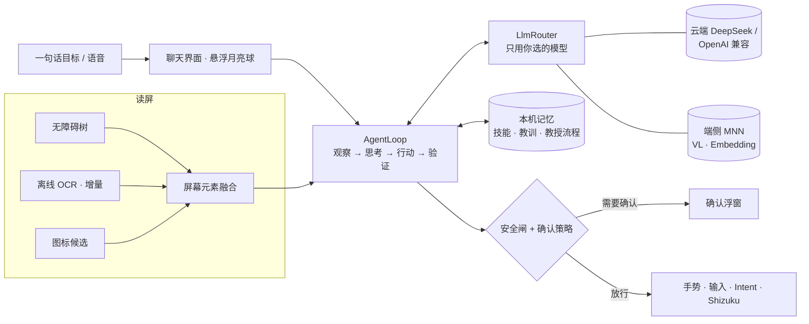

<p align="center">
  
  &nbsp;&nbsp;
  
</p>

<h1 align="center">Tsuki · 月</h1>

<p align="center">
  会自己动手、也会向你学习的 Android 手机智能体<br/>
  <sub>Autonomous Android phone agent on MNN — cloud-first, on-device assist, learns from you.</sub>
</p>

<p align="center">
  
  
  
  
</p>

用一句话说出目标，Tsuki 会读屏、思考，再在任意应用里一步步点按、输入、滑动直到完成，并实时展示每一步。决策交给云端大模型，看图、语义检索与语音在手机本机用 [MNN](https://github.com/alibaba/MNN) 完成；你教过的流程，它会记住并复用。

> 状态：MVP 预发布（当前 **0.14.2-mvp**）。主要在 **荣耀 MagicOS 10（Android 16）** 上开发与验证。

## ✨ 亮点

- **自主操作**：在任意应用里点按、长按、输入、滑动、滚动查找、跨应用复制粘贴、深链直达；读屏融合无障碍树、离线 OCR 与图标候选，游戏等自绘界面也能看图操作。
- **深 / 浅思考**：平时浅思考求快；卡住时自动转入深思考——强制看图、诊断原因、换一种没试过的策略，有进展后回到浅思考。
- **教我做**：口述或示范一遍，悬浮教练条跟你进任意应用记录步骤，整理成带占位符的可复用流程；之后同类任务优先按它执行。成功经验、失败教训和你的纠正也会持续沉淀。
- **端侧 MNN**：本机运行视觉模型（Qwen3-VL-2B）看图、bge-large-zh 语义检索经验、sherpa-onnx 离线语音识别；云端为主、本机为辅，断网时本机接管。
- **安全确认**：发消息、通话、支付、下单、卸载、设闹钟前必须由你确认；屏幕文字一律视为不可信数据以防提示注入；悬浮月亮球长按即急停。

## 🏗 架构



## 📦 安装

1. **APK**：从 [Releases](https://github.com/Runa-Asahi/tsuki-phone-agent/releases) 下载最新 `*-mvp` 预发布版并安装。
2. **无障碍**：设置 → 辅助功能 → 无障碍 → Tsuki → 开启（每次更新 APK 后请确认仍开启）。
3. **悬浮窗**：允许「显示在其他应用上层」，用于悬浮月亮球、确认与教练条。
4. **Shizuku（可选，推荐）**：用无线调试启动 Shizuku 后在 Tsuki 设置里授权，可获得按键注入、原始截图与无障碍掉线自愈。MagicOS 重启后需重新启动 Shizuku。
5. 荣耀 / MagicOS 建议：电池忽略优化、应用启动改为手动管理并允许自启动，在多任务界面锁定 Tsuki。
6. 打开 Tsuki → 菜单 → **自检**，全部通过后即可下任务。

## 🔑 模型配置

- **云端**：推荐 DeepSeek（Base URL `https://api.deepseek.com`），也支持任意 OpenAI 兼容服务。**API Key 只在应用设置页填写**，用 `EncryptedSharedPreferences` 加密保存，日志中一律遮罩；仓库与 APK 中不含任何 Key。
- **只用你选的模型**：不会自动升级或切换模型。
- **端侧模型**：设置 → 本机模型 / 学习 / 语音，一键从 [魔搭 ModelScope](https://modelscope.cn) 匿名下载（无需登录），支持断点续传与 sha256 校验：
  - 视觉：`MNN/Qwen3-VL-2B-Instruct-MNN`（约 1.5 GB）
  - 语义检索：`MNN/bge-large-zh-MNN`（约 217 MB）
  - 语音识别：sherpa-onnx 中文流式模型（约 25 MB）

## 🔒 隐私与安全

- 读屏、OCR、记忆、语音全部在本机处理；只有你配置了云端模型时，屏幕文字（以及你允许时的截图）才会发给**你选的**服务商。
- 不采集、不上传任何统计数据；诊断日志只在你点「导出」时生成，且会遮罩密钥。
- 支付 / 银行类应用直接交还给你；登录、验证码、人机验证默认由你本人处理。
- 学习记录可在「学习记录」页查看、编辑、删除或一键清空。

## 📱 支持设备

- 主要验证：**荣耀 PPG-AN00 · MagicOS 10（Android 16）**。
- 其他 Android 8.0+ 手机可用；端侧 MNN 模型仅支持 arm64。

## 🛠 从源码构建

需要 JDK 17 与 Android SDK 36。

```bash
git clone https://github.com/Runa-Asahi/tsuki-phone-agent && cd tsuki-phone-agent
git checkout feat/mvp-agent
echo "sdk.dir=/path/to/Android/Sdk" > local.properties
./gradlew :app:testDebugUnitTest :app:lintDebug :app:assembleDebug
```

- 带完整签名（v1+v2+v3）并校验证书的安装包：`scripts/build-signed-apk.sh`，再用 `scripts/verify-apk-signed.sh` 检查。
- `app/keystore/debug.keystore` 是 **Android 公开的调试证书，仅用于调试 / 预发布构建**，不具备任何安全性，请勿用于正式发布。
- 500+ 个 JVM 单元测试，以及驱动真实 AgentLoop 的离线手机模拟器（`app/src/test/.../sim/`）。
- 更多：[docs/HONOR_MAGICOS10.md](docs/HONOR_MAGICOS10.md) · [docs/ACCEPTANCE.md](docs/ACCEPTANCE.md) · [docs/CHECKLIST.md](docs/CHECKLIST.md)

## 📜 更新日志与许可

- 版本历史见 [CHANGELOG.md](CHANGELOG.md)。
- 许可：[Apache-2.0](LICENSE)。第三方组件（MNN、sherpa-onnx 等）遵循各自许可。
