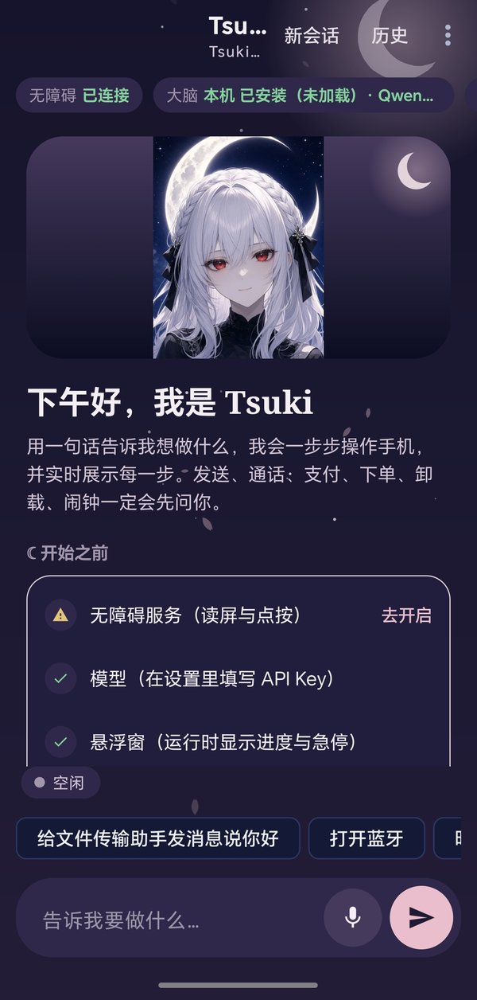
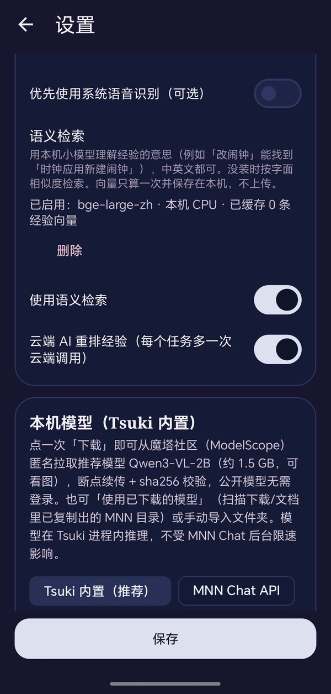
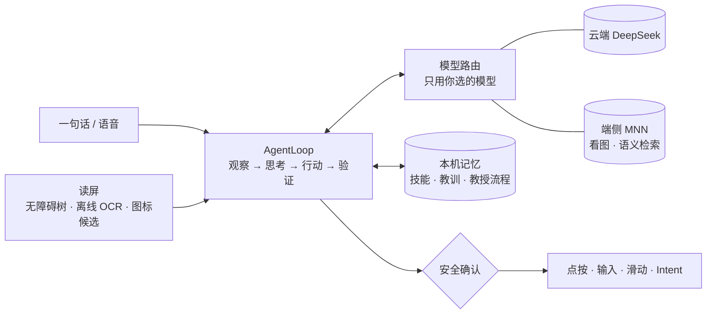

<div align="center">


# Tsuki · 月

**说一句话，手机自己动起来。**

<sub>Say it once — your phone does the rest. An autonomous Android phone agent on MNN.</sub>

<br/>

[](https://github.com/Runa-Asahi/tsuki-phone-agent/releases)
[](LICENSE)
[](docs/HONOR_MAGICOS10.md)
[](docs/HONOR_MAGICOS10.md)
[](https://github.com/alibaba/MNN)

</div>

---

> [!IMPORTANT]
> ### 📱 优先适配机型
> **荣耀 PPG-AN00** · MagicOS 10 · Android 16 · 骁龙 8 至尊领先版 · 2800 × 1264
>
> Tsuki 在这台手机上开发与实测。其他 Android 机型**未经验证**，可以安装尝试，但不保证效果。

## 它能为你做什么

| | |
|---|---|
| 🗣️ **一句话，手机自己动起来** | 说出或打出目标，比如「给王小明发微信说晚点到」，Tsuki 会读屏、思考，在任意应用里一步步点按、输入、滑动，每一步都实时展示给你。 |
| 🎓 **教一次就会** | 「教我做…」：你口述或示范一遍，悬浮教练条跟着你进任意应用记录步骤。之后同类任务直接照着做，做错时可以纠正它。 |
| 🌙 **卡住会自己深思** | 平时快速浅思考；原地打转时自动转入深思考：看截图、找原因、换一种没试过的做法，有进展后再回到快速模式。 |
| 👁️ **本机看图与语音** | 视觉模型、语义检索和离线语音识别都用 MNN / sherpa-onnx 在手机上运行，截图和录音不出手机。 |
| 🛡️ **危险操作必确认** | 发消息、打电话、支付、下单、卸载、设闹钟前一定先问你；屏幕上的文字一律不当指令；长按悬浮月亮球随时急停。 |

## 📸 界面截图

<div align="center">

<table>
  <tr>
    <td align="center"></td>
    <td align="center"></td>
  </tr>
  <tr>
    <td align="center"><sub><b>主页</b>：一句话下任务，上手清单与常用指令一目了然</sub></td>
    <td align="center"><sub><b>设置</b>：本机模型一键下载，语义检索可开可关</sub></td>
  </tr>
</table>

<sub>📱 拍摄于荣耀 PPG-AN00（状态栏已裁去）</sub>

</div>

## 🚀 快速开始

1. 从 [Releases](https://github.com/Runa-Asahi/tsuki-phone-agent/releases) 下载最新 APK 并安装。
2. 开启 **无障碍**：设置 → 辅助功能 → 无障碍 → Tsuki（每次更新 APK 后请再确认一次）。
3. 允许 **悬浮窗**（用于月亮球、确认框和教练条）。
4. 在 Tsuki 设置里填入 **DeepSeek API Key**，Key 只在应用内填写、加密保存。
5. 菜单 → **自检**，全部通过后就可以下任务了。

<details>
<summary><b>进阶设置：Shizuku、保活、端侧模型</b></summary>

- **Shizuku（推荐）**：开发者选项 → 无线调试 → 在 Shizuku 里配对启动，然后在 Tsuki 设置里授权。可以获得按键注入、更快的原始截图，以及无障碍掉线自动恢复。MagicOS 每次重启后需要重新启动 Shizuku。
- **荣耀保活**：电池 → 忽略优化；应用启动管理 → Tsuki 改为手动管理并允许自启动；在多任务界面锁定 Tsuki。
- **端侧模型**（设置内一键下载，来自 [魔搭 ModelScope](https://modelscope.cn)，无需登录，支持断点续传与 sha256 校验）：
  - 看图：`MNN/Qwen3-VL-2B-Instruct-MNN`（约 1.5 GB）
  - 语义检索：`MNN/bge-large-zh-MNN`（约 217 MB）
  - 语音识别：sherpa-onnx 中文流式模型（约 25 MB）
- **模型选择**：云端推荐 DeepSeek，也支持任意 OpenAI 兼容服务；Tsuki 只用你选的模型，不会自动切换。

</details>

## 🔒 隐私与安全

- 读屏、OCR、记忆、语音都在本机处理；只有配置了云端模型时，屏幕文字（以及你允许时的截图）才会发给**你选的**服务商。
- 不采集任何统计数据；诊断日志只在你手动导出时生成，密钥会被遮罩。
- 支付 / 银行类应用、登录、验证码、人机验证默认交还给你本人处理。
- 学到的经验和流程都在「学习记录」页，可以随时查看、编辑或清空。

## 🧠 工作原理



<details>
<summary><b>技术细节</b></summary>

- **读屏**：无障碍节点树、ML Kit 中文离线 OCR（只重新识别变化区域）、色块 / 角落图标候选并行融合；无障碍在线时不运行 `uiautomator`。
- **决策**：云端为主、本机为辅；浅 / 深两档思考，卡住时自动升级。系统提示保持稳定，便于前缀缓存命中。
- **端侧推理**：JNI + libMNN，自动探测 OpenCL → CPU；模型空闲时自动卸载以节省内存；仅 arm64。
- **学习**：成功步骤沉淀为可复用技能，失败归因转成教训，教授流程优先匹配；经验按字面与语义相似度检索，过期自动清理。
- **安全**：SafetyGate + ConfirmPolicy；屏幕文本视为不可信数据，输入内容只能来自你的目标或本次任务读到的信息。

</details>

## 🛠 从源码构建

```bash
git clone https://github.com/Runa-Asahi/tsuki-phone-agent && cd tsuki-phone-agent
echo "sdk.dir=/path/to/Android/Sdk" > local.properties   # JDK 17 + Android SDK 36
./gradlew :app:testDebugUnitTest :app:lintDebug :app:assembleDebug
```

- 带 v1 + v2 + v3 签名的安装包：`scripts/build-signed-apk.sh`，然后用 `scripts/verify-apk-signed.sh` 校验。
- `app/keystore/debug.keystore` 是 Android 公开的**调试证书，仅用于调试 / 预发布构建**，请勿用于正式发布。
- 更多文档：[MagicOS 适配](docs/HONOR_MAGICOS10.md) · [验收清单](docs/ACCEPTANCE.md) · [真机核对](docs/CHECKLIST.md)

## 📜 更新日志与许可

[CHANGELOG.md](CHANGELOG.md) · [Apache-2.0](LICENSE)。第三方组件（MNN、sherpa-onnx 等）遵循各自许可。

<div align="center"><sub>🌙 Made for Honor PPG-AN00</sub></div>
