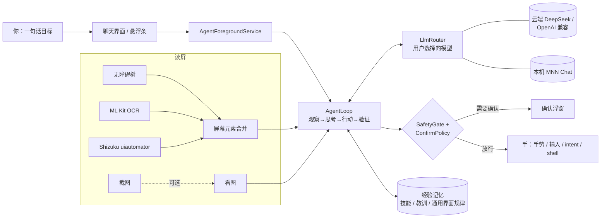

<p align="center">
  
  &nbsp;&nbsp;
  
</p>

# 荣耀手机 Agent · Tsuki

一个**在手机本机运行**的安卓操作 Agent：用一句中文（或英文）说出目标，助手 **Tsuki（月）** 会读屏、思考，再一步步点按、输入、滑动来完成任务，并实时展示每一步。主要面向 **荣耀 PPG-AN00 / MagicOS 10（Android 16）**，其他 Android 8+ 手机同样可以用。

- 包名：`com.runasakura.phoneagent`（debug 版为 `.debug`）· 许可：Apache-2.0
- 开发分支：`feat/mvp-agent`（不直接改 `main`）· 当前版本：**0.8.0-mvp**

> Tsuki 是助手的形象：银色长发、编发头带、黑色缎带、红瞳、月牙。应用名称保持「荣耀手机 Agent」。

---

## 功能

| 能力 | 说明 |
|---|---|
| 通用操作 | 任意应用里的点按 / 长按 / 双击 / 输入 / 滑动 / `scroll_find` / 返回 / 桌面 / 通知栏 / 快捷设置 / 分屏 |
| 直达工具 | `launch`、`list_apps`（查已安装应用）、`open_url`、`intent`、剪贴板 `copy/paste`、`key enter` |
| 读屏 | 无障碍节点树 → 端侧 ML Kit 中文 OCR（离线）→ 截图看图（可选）→ Shizuku `uiautomator` 补全空树；多来源合并 |
| 看图 | `deepseek-flash` 可以直接看截图（需要在设置里允许）；也可以用本机 MNN VL 或云端 VL 作为看图辅助 |
| 模型 | 本机 MNN Chat（OpenAI 兼容）或云端 DeepSeek / OpenAI 兼容；**只用你选的模型**，不会自动切换 |
| 安全 | ConfirmPolicy：发送 / 通话 / 支付 / 下单 / 卸载 / 闹钟前必须确认；提示注入防护；急停 |
| 学习 | 应用经验、可复用技能、失败归因、在线换法、从你的回答和纠正中学习（全部在本机） |
| 常驻 | 无障碍掉线自愈（WRITE_SECURE_SETTINGS / Shizuku）、开机/更新自愈、可选保活 |
| 外观 | Tsuki 主题：夜月（默认）/ 樱 / 纯月，深浅色；月光动效（系统关闭动画时静止） |

## 架构



一步的流程：读屏（树 + OCR，必要时截图）→ 生成观察（上一步效果、经验提示、屏幕元素）→ 模型输出一个 JSON 动作 → 安全闸 / 校验 → 执行 → 对比界面变化 → 达成后由验收员确认。系统提示保持不变，方便 DeepSeek 前缀缓存命中。

## 安装与设置（荣耀 PPG-AN00）

1. **安装 APK**：从 [Releases](https://github.com/Runa-Asahi/honor-phone-agent/releases) 下载最新 `*-mvp` 预发布版。
2. **无障碍**：设置 → 辅助功能 → 无障碍 → 本应用 → 开启。**每次更新 APK 后**都要确认它仍然开着（首页「上手清单」会提示）。
3. **悬浮窗**：允许「显示在其他应用上层」（用于进度条、急停、确认）。
4. **通知**：允许（后台任务状态）。
5. **电池 / 自启动**：设置 → 电池 → 忽略优化；手机管家 → 应用启动管理 → 本应用改为「手动管理」，打开自启动、关联启动、后台活动；在多任务界面锁定本应用。
6. **Shizuku（可选，推荐）**：
   - 安装 Shizuku → 开发者选项 → **无线调试** → 在 Shizuku 里配对并启动。
   - MagicOS **每次重启后 Shizuku 都会停止**，需要回到 Shizuku 用无线调试重新启动。
   - 本应用 设置 → 特权模式（Shizuku，可选）→ 请求授权 → 打开开关。之后会得到：空界面树补全、更稳的截图与输入，以及 `shell` 工具（危险命令始终需要确认）。
7. **无障碍自愈**：Shizuku 就绪时，在 设置 → 后台保活（荣耀/MagicOS）→ 「用 Shizuku 授予自愈权限」点一次，授予 `WRITE_SECURE_SETTINGS`。之后服务被系统关掉时会自动重新开启，即使 Shizuku 没有运行、手机重启后也一样。
   - 也可以用 adb：`adb shell pm grant com.runasakura.phoneagent android.permission.WRITE_SECURE_SETTINGS`
8. 打开应用 → 右上角菜单 → **自检**，全部通过后再下任务。

## 模型配置

设置 → 模型：

| 方式 | 说明 |
|---|---|
| **DeepSeek（推荐）** | Base URL `https://api.deepseek.com`，模型 `deepseek-flash`（快、便宜、可以看图）；需要更强时可以手动选 `deepseek-v4-pro` |
| 思考模式 | 「DeepSeek 思考模式」开关，更准但更慢，默认关 |
| 看图 | 勾选「允许向云端发送截图」后，游戏 / 图标 / 自绘界面会附带截图 |
| 本机 MNN | 安装 MNN Chat 并启动 API（`http://127.0.0.1:8080/v1`），选用 Instruct 小模型（不要用长思考模型）；路由选「仅本机」或「本机优先」 |
| OpenAI 兼容 | 自填 Base URL / 模型 |

- **API Key 只在设置页填写**，保存在 `EncryptedSharedPreferences`（AES-GCM）里；日志和诊断只显示遮罩，不要在聊天里粘贴 Key。
- 模型只用你选的那一个：不会自动升级，也不会切换到 pro。

## 安全与 ConfirmPolicy

- **发送消息、拨打电话、支付 / 转账、下单、卸载、设置闹钟**之前，一定会弹出确认（显示对象和内容），你同意后才执行；拒绝也会被记住。
- 普通 `https` 链接直接打开，不需要确认。
- 支付 / 银行类应用直接拦截，交给你手动操作。验证码 / 登录页默认停下，只有你的目标本身就是「填写这个验证码」时才继续。
- 屏幕上的文字一律当作不可信数据：其中的「指令」会被忽略。输入的文字只能来自你的目标、复制得到的内容，或本次任务在屏幕上读到的信息。
- 急停：悬浮条 / 通知 / 首页按钮随时可以停止。

## 学习与经验记忆

全部只保存在本机，可以在设置里查看和清除：

- **应用经验**：每个应用的教训和事实，按与当前目标的相关性检索；矛盾时用新证据替换旧的。
- **可复用技能**：成功任务中真正让界面变化的步骤会沉淀成技能，自动去掉绕路和失败步骤。下次每一步给出「下一步建议」，仍然由模型判断是否采用。同一目标再次成功，技能的验证次数就增加；失败则降级。
- **通用界面规律**：跨应用适用的经验，比如开屏广告、底部 tab、搜索框。
- **失败归因**：分类为循环、找不到目标、步数耗尽、需要你、你拒绝等，转成下次可用的教训。
- **在线换法**：任务中某个动作失败后，换一种做法成功，会记成「X 不行，Y 可以」。
- **从你的回答学习**：追问的回答和急停 / 拒绝都会成为教训。
- **记忆卫生**：只出现一次的教训 10 天过期，验证过的 30 天过期；数量有上限。
- 经验只在任务开头注入一次，不在每一步重复发送，对前缀缓存友好。

## 外观（Tsuki）

- 主题：**夜月**（午夜蓝 + 月光银，默认）/ **樱**（樱粉，空状态用 Q 版形象）/ **纯月**（月白），各自支持跟随系统 / 深色 / 浅色（设置 → 外观）。
- 自适应图标（含单色主题图标）、Android 12 启动页、星空渐变背景、月相加载指示。系统关闭动画时，动效会静止。
- 无障碍：主要按钮的触控区为 48dp、TalkBack 描述、标题标记、对比度 ≥ 4.5:1（有单元测试检查）。
- 原图在 `branding/source/`，可以用 `python3 branding/make_assets.py` 重新生成全部图标和插画。

## 隐私

- 读屏、OCR、经验记忆都在本机。只有你配置了云端模型时，屏幕文字（以及你允许时的截图）才会发给**你选的**服务商。
- 不采集、不上传任何统计数据。诊断日志只有在你点「导出」时才会生成，Key 会被遮罩。

## 从源码构建

```bash
git clone https://github.com/Runa-Asahi/honor-phone-agent && cd honor-phone-agent
git checkout feat/mvp-agent
echo "sdk.dir=/path/to/Android/Sdk" > local.properties   # 需要 JDK 17 + Android SDK 36
./gradlew :app:testDebugUnitTest :app:lintDebug :app:assembleDebug
# 产物：app/build/outputs/apk/debug/app-debug.apk
```

## 测试与模拟器

- 400+ 个 JVM 单元测试，包括 Robolectric 界面回归测试。
- **离线模拟器**（`app/src/test/.../sim/`）：用脚本化的「手机世界」驱动**真实的** AgentLoop（解析、校验、安全闸、对话记录、恢复、云端客户端都不替换），覆盖消息、设置、购物、视频流、游戏、Shizuku、学习（第二次运行步数更少）等场景。
- **留出泛化套件**（`HeldOut.kt`，17 个虚构的新应用和新任务，编写提示词时没有用过）：英文界面、横屏、小屏、陌生弹窗 / 错误态、纯 OCR 画布、空界面树、长列表、跨应用复制 / 读后写、键盘遮挡按钮、长按菜单、直达链接、只在真正缺信息时才追问、过早完成被拦截。
- `SimTokenReport` 统计每步 token（全场景平均约 1.3k prompt tokens）。

## 已知限制 / 真机待验证

- 模拟器不能代替真机：MagicOS 的手势、输入法、无障碍掉线、Shizuku 重启行为仍需在 PPG-AN00 上确认。
- 自绘界面（游戏 / Canvas）需要能看图的模型，并允许截图；否则会停下而不是盲点。
- 登录、验证码、人机验证需要你本人处理（目标明确要求填写验证码时除外）。
- 本机小模型在多应用长任务上明显弱于云端模型。
- 每次更新 APK 后，请确认无障碍服务仍然开启；Shizuku 重启后需要重新启动。

## 版本摘要

- **0.8.0-mvp**：泛化能力专项（留出套件 13/17 → 17/17）；第二轮学习（技能蒸馏、失败归因、在线换法、从纠正中学习、记忆卫生）；Tsuki 品牌与 UI 重设计（三套主题、自适应 / 单色图标、启动页、上手清单、无障碍）；可选 Shizuku 后端；无障碍掉线自愈；常见应用通用适配；本 README。
- **0.7.0-mvp**：闹钟确认需要时间选择器上下文、悬浮条避让手势、设置页整理。
- **0.6.x**：离线模拟器、确认后发送修复、跨应用复制粘贴、观察压缩、循环恢复阶梯、错误分类与退避重试。
- **0.5.0**：模型可以看截图。**0.4.0**：对话式体验。**0.2.x**：路由修复、本机 / 云端协作、提示注入防护、微信通话确认。

更多：[docs/HONOR_MAGICOS10.md](docs/HONOR_MAGICOS10.md) · [docs/ACCEPTANCE.md](docs/ACCEPTANCE.md)
